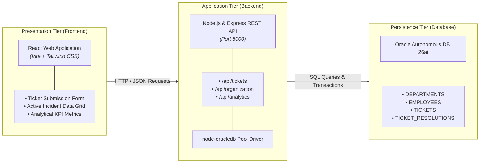
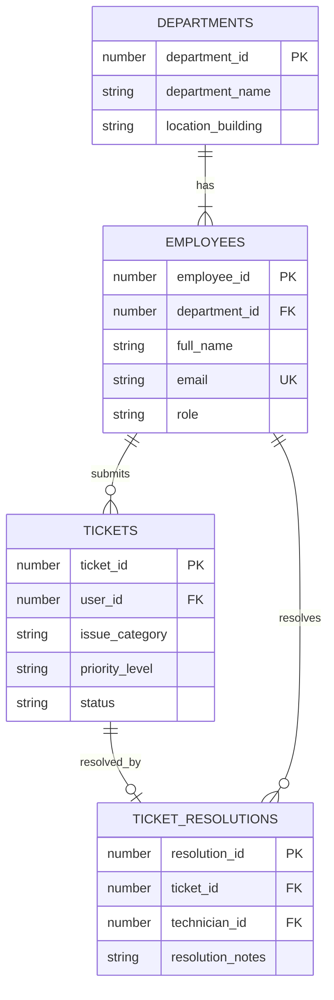

# IT Service Desk Ticketing System

> **Database Systems Project** &bull; Vellore Institute of Technology (VIT)  
> Relational Database Management System built on **Oracle SQL**, **Node.js (Express)**, and **React**.

---

## 📌 Project Overview

The **IT Service Desk Ticketing System** is an enterprise-grade incident management and service request tracking application. It models operational IT workflows—from issue logging and triage to technician dispatch, resolution verification, and organizational reporting.

The system is engineered using a normalized **Entity-Relationship (ER) model** running strictly on an **Oracle Relational Database**, connected to a **Node.js REST API bridge** using the native `node-oracledb` driver, and visualized through a modern, responsive **React dashboard**.

---


## 🏗️ System Architecture



---

## 🗄️ Relational Database Schema

The database design strictly enforces referential integrity, domain constraints, and cascade policies across four relational tables:



### Table Specifications

#### 1. `DEPARTMENTS`
* `department_id` (`NUMBER`, PK): Unique department identifier.
* `department_name` (`VARCHAR2(100)`, NOT NULL): Organizational department name (e.g., *Information Technology*, *Software Engineering*).
* `location_building` (`VARCHAR2(100)`, NOT NULL): Physical campus building/floor location.

#### 2. `EMPLOYEES`
* `employee_id` (`NUMBER`, PK): Unique employee identification number.
* `department_id` (`NUMBER`, FK $\rightarrow$ `DEPARTMENTS.department_id`): Associated department with `ON DELETE CASCADE`.
* `full_name` (`VARCHAR2(100)`, NOT NULL): Employee's full name.
* `email` (`VARCHAR2(150)`, UNIQUE, NOT NULL): Corporate email address.
* `role` (`VARCHAR2(20)`, CHECK): Constrained to `('USER', 'TECHNICIAN', 'ADMIN')`.

#### 3. `TICKETS`
* `ticket_id` (`NUMBER`, PK): Unique incident tracking identifier.
* `user_id` (`NUMBER`, FK $\rightarrow$ `EMPLOYEES.employee_id`): The employee who reported the incident.
* `issue_category` (`VARCHAR2(100)`, NOT NULL): Incident category (e.g., *Hardware Failure*, *Network & VPN*, *Access Permissions*).
* `priority_level` (`VARCHAR2(20)`, CHECK): Constrained to `('LOW', 'MEDIUM', 'HIGH', 'CRITICAL')`.
* `status` (`VARCHAR2(20)`, DEFAULT `'OPEN'`, CHECK): Incident lifecycle status: `('OPEN', 'IN_PROGRESS', 'RESOLVED', 'CLOSED')`.
* `created_at` (`TIMESTAMP`, DEFAULT `CURRENT_TIMESTAMP`): Submission timestamp.

#### 4. `TICKET_RESOLUTIONS`
* `resolution_id` (`NUMBER`, PK): Unique resolution record key.
* `ticket_id` (`NUMBER`, FK $\rightarrow$ `TICKETS.ticket_id`, UNIQUE): 1-to-1 relationship with `TICKETS` (`ON DELETE CASCADE`).
* `technician_id` (`NUMBER`, FK $\rightarrow$ `EMPLOYEES.employee_id`): The assigned technician resolving the issue.
* `resolution_notes` (`VARCHAR2(1000)`, NOT NULL): Technical steps taken to resolve the incident.
* `resolved_at` (`TIMESTAMP`, DEFAULT `CURRENT_TIMESTAMP`): Incident resolution timestamp.

---

## 🛠️ Technology Stack

* **Database Engine**: Oracle Autonomous Database (Always Free Tier) / Oracle Database 26ai (Local Docker / XE).
* **Backend Runtime**: Node.js (`v20+`)
* **API Framework**: Express.js
* **Database Driver**: `node-oracledb` (Native Thin/Thick client with connection pooling)
* **Frontend**: React (Vite bundler)
* **Styling**: Tailwind CSS / Vanilla CSS

---

## 📅 Evaluation Roadmap & Milestones

### 🔹 Review 1: Core Relational Model & SQL Foundations (10 Marks)
- [x] **DDL Implementation (`sql/01_schema.sql`)**: Ordered table creation with PK, FK, CHECK constraints, and DEFAULT values.
- [x] **Schema Modification Demonstrations (`ALTER TABLE`, `DROP TABLE`)**: Adding columns, altering constraints, and safe teardown procedures.
- [x] **DML & Mock Dataset (`sql/02_seed_data.sql`)**: Populating realistic operational test data, update workflows, and deletion triggers.
- [x] **Analytical Queries (`sql/03_review1_queries.sql`)**:
  - *Single-Row Functions*: `UPPER()`, `LOWER()`, `INITCAP()`, `TO_CHAR()`, and `NVL()` for NULL resolution handling.
  - *Group & Aggregate Functions*: `COUNT()`, `AVG()`, `GROUP BY`, and `HAVING` (e.g., filtering priority queues with $\ge 2$ pending tickets).
- [x] **Application Bridge**:
  - Express.js server executing raw Oracle SQL statements.
  - Single-page React dashboard with ticket creation form, active incident grid, and aggregate metrics.

### 🔹 Review 2: Advanced Database Architecture & Enterprise Features (20 Marks)
- [ ] **Database Triggers**:
  - Audit logging when ticket statuses change.
  - Automatic `updated_at` / `resolved_at` timestamp management.
- [ ] **PL/SQL Stored Procedures & Functions**:
  - Automated technician assignment based on department and current ticket load.
  - SLA computation and escalation procedures.
- [ ] **Concurrency Control & Transaction Isolation**:
  - Row-level locking (`SELECT ... FOR UPDATE`) to prevent race conditions when multiple technicians attempt to claim the same ticket concurrently.
  - ACID transaction commit/rollback controls.
- [ ] **Advanced Views & Materialized Views**:
  - Optimized multi-table reporting views across all 4 entities for fast dashboard access without repetitive joins.

---

## 📂 Repository Structure

```text
ticketing-system/
├── client/                     # Frontend Application (React + Vite)
│   ├── src/
│   │   ├── App.jsx             # Main Dashboard (Forms, Grids, Metrics)
│   │   ├── main.jsx            # React root mount
│   │   └── index.css           # Styling & theme variables
│   ├── package.json            # Client dependencies & scripts
│   └── vite.config.js          # Vite build & reverse-proxy configuration
│
├── server/                     # Backend API Bridge (Express.js)
│   ├── config/                 # Oracle DB pool configuration (oracledb)
│   ├── routes/                 # Express REST endpoint modules
│   ├── .env.example            # Environment variable template
│   ├── package.json            # Server dependencies & scripts
│   └── server.js               # Express application entrypoint
│
├── sql/                        # Oracle SQL Scripts
│   ├── 01_schema.sql           # DDL: Table definitions & constraints
│   ├── 02_seed_data.sql        # DML: Mock inserts, UPDATE & DELETE tests
│   └── 03_review1_queries.sql  # Analytical SQL: Single-row & aggregate queries
│
├── .gitignore                  # Git ignore rules (node_modules, wallets, .env)
├── README.md                   # Complete project documentation
└── rules.md                    # Academic lab requirements & rubrics
```

---

## 🚀 Getting Started & Local Setup

### 1. Prerequisites
* **Node.js**: `v20.x` or higher
* **npm**: `v10.x` or higher
* **Oracle Database**: Oracle Autonomous Database cloud wallet **OR** local Oracle instance / container.

### 2. Clone the Repository
```bash
git clone https://github.com/ArnavGoel77/ticketing-system.git
cd ticketing-system
```

### 3. Database Initialization
Execute the SQL scripts in your Oracle SQL Developer, SQLcl, or Oracle APEX interface in sequential order:
1. Run `sql/01_schema.sql` to build the tables.
2. Run `sql/02_seed_data.sql` to populate sample data.
3. Run `sql/03_review1_queries.sql` to test the analytical queries.

### 4. Backend Setup
```bash
cd server
npm install
```
Configure your database connection by copying `.env.example` to `.env`:
```bash
cp .env.example .env
```
Edit `.env` with your Oracle connection credentials:
```env
PORT=5000
DB_USER=ADMIN
DB_PASSWORD=your_secure_password
DB_CONNECT_STRING=your_oracle_connection_string_or_tns_alias
```
Start the API server:
```bash
npm run dev   # or npm start
```

### 5. Frontend Setup
In a new terminal window:
```bash
cd client
npm install
npm run dev
```
Open `http://localhost:3000` (or the Vite dev URL provided in the console) to access the dashboard.

---

## 📄 License & Academic Integrity

This project is developed solely for educational and evaluation purposes for the **Database Systems** course at **Vellore Institute of Technology**. All rights reserved.