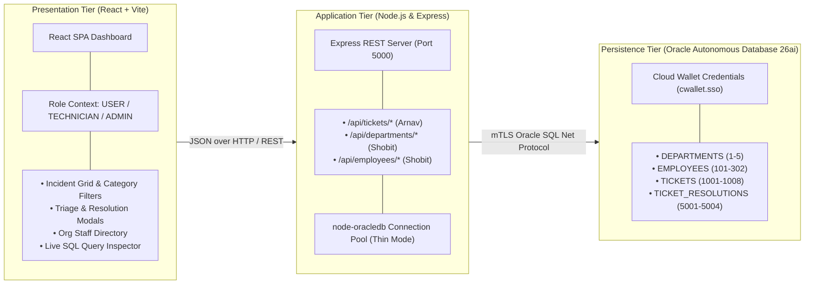
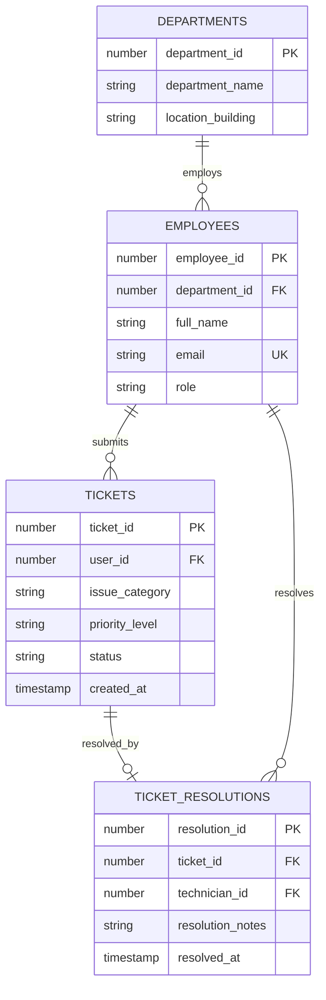

# IT Service Desk Incident & Ticketing System

> **DBMS Laboratory Project (Review 1 & 2)** &bull; Vellore Institute of Technology (VIT)  
> Full-Stack Enterprise Incident Management & IT Service Desk built on **Oracle Cloud Autonomous Database 26ai (ATP)**, **Node.js (Express REST API)**, and **React (Vite)**.

---

## 📋 Table of Contents
1. [Project Overview & Vision](#-project-overview--vision)
2. [Team Division & Ownership](#-team-division--ownership)
3. [System Architecture](#-system-architecture)
4. [Relational Database Design & Schema](#-relational-database-design--schema)
5. [Review 1 SQL Syllabus & Rubric Mapping](#-review-1-sql-syllabus--rubric-mapping)
6. [REST API Contract & Endpoints](#-rest-api-contract--endpoints)
7. [User Experience & Role-Based Access Control (RBAC)](#-user-experience--role-based-access-control-rbac)
8. [Project File Structure](#-project-file-structure)
9. [Step-by-Step Setup & Execution Guide](#-step-by-step-setup--execution-guide)
10. [Review 1 Viva & Oral Exam Cheat Sheet](#-review-1-viva--oral-exam-cheat-sheet)
11. [Review 2 Architectural Roadmap](#-review-2-architectural-roadmap)

---

## 📌 Project Overview & Vision

The **IT Service Desk Incident & Ticketing System** models operational enterprise IT workflows—from incident logging, triage, and technician dispatch to resolution sign-off and SLA performance auditing.

### Key Objectives
- **ACID-Compliant Relational Core:** Eliminates orphaned tickets and unauthorized resolutions through primary keys, foreign keys, identity columns, domain check constraints, and cascade policies.
- **Enterprise Database Engine:** Runs on Oracle Cloud Autonomous Transaction Processing (ATP 26ai/19c) with secure Mutual TLS (mTLS) wallet connectivity.
- **Role-Based Workflows:** Tailored interfaces for **End Users** (log/track issues), **Support Technicians** (triage, investigate, resolve incidents), and **System Administrators** (staff registration, ticket lifecycle deletion, organizational oversight).
- **Embedded Analytical SQL:** Pre-built, live-executing single-row and aggregate analytical queries evaluating resolution speed, backlog thresholds, and departmental workload.

---

## 👥 Team Division & Ownership

To ensure parallel development and zero git merge conflicts, the project is strictly partitioned into two independent functional modules:

| Metric | Arnav Goel (Arnav's Module) | Shobit (Shobit's Module) |
| :--- | :--- | :--- |
| **Functional Domain** | **Ticket & Incident Management** | **Identity & Organization Management** |
| **Relational Tables** | `TICKETS`, `TICKET_RESOLUTIONS` | `DEPARTMENTS`, `EMPLOYEES` |
| **REST API Prefix** | `/api/tickets` | `/api/departments`, `/api/employees` |
| **Seed ID Range** | Tickets: `1001`–`1008`<br/>Resolutions: `5001`–`5004` | Departments: `1`–`5`<br/>Employees: `101`–`302` |
| **Schema DDL Script** | `sql/01_schema.sql` | `sql/shobit_01_schema.sql` |
| **Seed DML Script** | `sql/02_seed_data.sql` | `sql/shobit_02_seed_data.sql` |
| **Analytical SQL Script**| `sql/03_review1_queries.sql` | `sql/shobit_03_queries.sql` |
| **Review 1 DDL Demo** | `sql/scratch_ddl_demo.sql` (`ALTER`, `DROP PURGE`) | — |

---

## 🏗️ System Architecture



### Technology Highlights
- **Database:** Oracle Autonomous Database 26ai / 19c ATP (Always Free Cloud Tier).
- **Backend Bridge:** Node.js `v20+`, Express.js, `oracledb` `v6.6+` using high-performance connection pooling.
- **Frontend Client:** React 19, Vite, custom Vanilla CSS design tokens with smooth glassmorphism, responsive sidebar navigation, and on-screen modal popups.

---

## 🗄️ Relational Database Design & Schema

### Entity-Relationship (ER) Diagram



### Relational Table Definitions

#### 1. `DEPARTMENTS` (Owner: Shobit &bull; `sql/shobit_01_schema.sql`)
Represents functional units and campus facility locations.
```sql
CREATE TABLE DEPARTMENTS (
    department_id     NUMBER GENERATED BY DEFAULT AS IDENTITY PRIMARY KEY,
    department_name   VARCHAR2(100) NOT NULL,
    location_building VARCHAR2(50)
);
```

#### 2. `EMPLOYEES` (Owner: Shobit &bull; `sql/shobit_01_schema.sql`)
Tracks all organizational personnel with distinct operational roles.
```sql
CREATE TABLE EMPLOYEES (
    employee_id   NUMBER GENERATED BY DEFAULT AS IDENTITY PRIMARY KEY,
    department_id NUMBER REFERENCES DEPARTMENTS(department_id) ON DELETE SET NULL,
    full_name     VARCHAR2(100) NOT NULL,
    email         VARCHAR2(150) NOT NULL UNIQUE,
    role          VARCHAR2(20)  NOT NULL 
                  CHECK (role IN ('USER', 'TECHNICIAN', 'ADMIN'))
);
```

#### 3. `TICKETS` (Owner: Arnav &bull; `sql/01_schema.sql`)
Records incident reports, issue categories, triage priorities, and lifecycle status.
```sql
CREATE TABLE TICKETS (
    ticket_id      NUMBER GENERATED BY DEFAULT AS IDENTITY PRIMARY KEY,
    user_id        NUMBER NOT NULL REFERENCES EMPLOYEES(employee_id) ON DELETE CASCADE,
    issue_category VARCHAR2(50) NOT NULL,
    priority_level VARCHAR2(20) DEFAULT 'MEDIUM' NOT NULL 
                   CHECK (priority_level IN ('LOW', 'MEDIUM', 'HIGH', 'CRITICAL')),
    status         VARCHAR2(20) DEFAULT 'OPEN' NOT NULL 
                   CHECK (status IN ('OPEN', 'IN_PROGRESS', 'RESOLVED', 'CLOSED')),
    created_at     TIMESTAMP DEFAULT CURRENT_TIMESTAMP NOT NULL
);
```

#### 4. `TICKET_RESOLUTIONS` (Owner: Arnav &bull; `sql/01_schema.sql`)
Enforces a strict 1-to-1 relationship with `TICKETS`, logging the resolving technician, detailed resolution notes, and completion timestamp.
```sql
CREATE TABLE TICKET_RESOLUTIONS (
    resolution_id    NUMBER GENERATED BY DEFAULT AS IDENTITY PRIMARY KEY,
    ticket_id        NUMBER NOT NULL UNIQUE REFERENCES TICKETS(ticket_id) ON DELETE CASCADE,
    technician_id    NUMBER NOT NULL REFERENCES EMPLOYEES(employee_id),
    resolution_notes VARCHAR2(1000) NOT NULL,
    resolved_at      TIMESTAMP DEFAULT CURRENT_TIMESTAMP NOT NULL
);
```

### Key Schema Design Decisions
1. **Modern Identity Columns (`GENERATED BY DEFAULT AS IDENTITY`):** Employs Oracle 12c+ native identity generation rather than creating separate sequence and `BEFORE INSERT` trigger pairs, drastically improving insert throughput.
2. **Referential Cascade Policies:**
   - `TICKETS` $\rightarrow$ `EMPLOYEES`: `ON DELETE CASCADE` (if an employee profile is permanently expunged, their incident tickets are removed).
   - `TICKET_RESOLUTIONS` $\rightarrow$ `TICKETS`: `ON DELETE CASCADE` (deleting an incident cleanly purges its resolution log).
   - `EMPLOYEES` $\rightarrow$ `DEPARTMENTS`: `ON DELETE SET NULL` (decommissioning a department does not delete corporate employees; their department link is safely set to `NULL`).
3. **1-to-1 Enforcement:** `ticket_id` in `TICKET_RESOLUTIONS` has a `UNIQUE` constraint, guaranteeing that an incident can only ever be resolved once.

---

## 📊 Review 1 SQL Syllabus & Rubric Mapping

Review 1 evaluates core relational modeling, constraint enforcement, DDL modifications, DML transactions, single-row functions, and aggregate group functions. Below is the comprehensive mapping:

### 1. DDL (Data Definition Language)
- **Table Creation:** Executed in strict dependency sequence (`DEPARTMENTS` $\rightarrow$ `EMPLOYEES` $\rightarrow$ `TICKETS` $\rightarrow$ `TICKET_RESOLUTIONS`) in `sql/shobit_01_schema.sql` and `sql/01_schema.sql`.
- **Alter Table Demonstrations (`sql/scratch_ddl_demo.sql`):**
  ```sql
  -- Add column
  ALTER TABLE TICKETS ADD updated_at TIMESTAMP DEFAULT CURRENT_TIMESTAMP;

  -- Modify column width
  ALTER TABLE TICKETS MODIFY issue_category VARCHAR2(100);

  -- Add named check constraint
  ALTER TABLE TICKET_RESOLUTIONS ADD CONSTRAINT chk_notes_nonempty 
  CHECK (LENGTH(TRIM(resolution_notes)) > 0);

  -- Drop constraint
  ALTER TABLE TICKET_RESOLUTIONS DROP CONSTRAINT chk_notes_nonempty;

  -- Drop column
  ALTER TABLE TICKETS DROP COLUMN updated_at;
  ```
- **Drop Table with PURGE (`sql/scratch_ddl_demo.sql`):**
  ```sql
  -- Scratch staging table creation and safe drop with purge
  CREATE TABLE TEMP_INCIDENT_STAGING (
      staging_id NUMBER GENERATED BY DEFAULT AS IDENTITY PRIMARY KEY,
      raw_payload VARCHAR2(500)
  );
  DROP TABLE TEMP_INCIDENT_STAGING PURGE;
  ```

### 2. DML (Data Manipulation Language)
- **Controlled Seed Data (`sql/shobit_02_seed_data.sql` & `sql/02_seed_data.sql`):**
  - Inserts 5 departments (`IT Support`, `Engineering`, `HR`, `Finance`, `Operations`).
  - Inserts 11 employees partitioned across 6 `USER`s, 3 `TECHNICIAN`s, and 2 `ADMIN`s.
  - Inserts 8 incident tickets spanning `NETWORK`, `HARDWARE`, `SOFTWARE`, `ACCOUNT_ACCESS`, and `EMAIL`.
  - Inserts 4 resolutions linking technicians `201`–`203` to tickets `1001`–`1004`.
- **Update & Delete Workflows:**
  - Status updates (`OPEN` $\rightarrow$ `IN_PROGRESS` $\rightarrow$ `RESOLVED`).
  - Demonstration ticket delete verifying cascade removal from `TICKET_RESOLUTIONS`.

### 3. Single-Row Functions
| Function | Purpose in Project | File & Query |
| :--- | :--- | :--- |
| `TO_CHAR()` | Formats raw Oracle timestamps to corporate `DD-Mon-YYYY HH24:MI:SS` and extracts day of week (`'Day'`). | `sql/03_review1_queries.sql` (Q1.1) |
| `UPPER()` / `LOWER()` | Standardizes incident categories to uppercase and normalizes email casing. | `sql/03_review1_queries.sql` (Q1.1), `sql/shobit_03_queries.sql` (Q1.1) |
| `INITCAP()` | Converts mixed-case building names to proper title case (e.g. `'tech tower'` $\rightarrow$ `'Tech Tower'`). | `sql/shobit_03_queries.sql` (Q1.2) |
| `LENGTH()` | Audits employee name character counts to verify display constraints. | `sql/shobit_03_queries.sql` (Q1.1) |
| `SUBSTR()` / `LPAD()` | Synthesizes employee badge IDs (`'EMP-0101'`) and directory badges. | `sql/shobit_03_queries.sql` (Q1.3) |
| `NVL()` | Handles unresolved incident tickets by substituting `'Pending Assignment / Active Triage'` for `NULL` resolution notes in outer joins. | `sql/03_review1_queries.sql` (Q1.2) |
| `ROUND()` | Calculates turnaround duration in hours rounded to 2 decimal places using date arithmetic: `ROUND((CAST(r.resolved_at AS DATE) - CAST(t.created_at AS DATE)) * 24, 2)`. | `sql/03_review1_queries.sql` (Q1.3) |

### 4. Group & Aggregate Functions (`GROUP BY` & `HAVING`)
| Query / Concept | Description | SQL Snippet |
| :--- | :--- | :--- |
| **Priority Queue Threshold (`HAVING COUNT >= 2`)** | Identifies congested queues by grouping active incidents by priority and filtering groups with at least 2 tickets. | `SELECT priority_level, COUNT(*) FROM TICKETS WHERE status IN ('OPEN','IN_PROGRESS') GROUP BY priority_level HAVING COUNT(*) >= 2;` |
| **Department Headcount (`HAVING COUNT >= 2`)** | Tallies assigned personnel per department and filters departments with 2 or more staff members. | `SELECT d.department_name, COUNT(e.employee_id) FROM DEPARTMENTS d JOIN EMPLOYEES e ON d.department_id = e.department_id GROUP BY d.department_name HAVING COUNT(e.employee_id) >= 2;` |
| **Status Distribution & Percentages** | Computes absolute volume and percentage share across operational statuses for dashboard KPI cards. | `SELECT status, COUNT(*), ROUND(COUNT(*)*100.0/(SELECT COUNT(*) FROM TICKETS), 1) FROM TICKETS GROUP BY status;` |
| **Turnaround Time Metrics (`AVG`, `MIN`, `MAX`)** | Computes fastest, average, and slowest resolution turnaround hours across resolved tickets. | `SELECT ROUND(AVG((CAST(r.resolved_at AS DATE) - CAST(t.created_at AS DATE)) * 24), 2) AS avg_hours FROM TICKET_RESOLUTIONS r JOIN TICKETS t ON r.ticket_id = t.ticket_id;` |
| **Staffing Matrix Breakdown** | Uses conditional aggregation (`COUNT(CASE WHEN...)`) to produce an org matrix with technician, user, and admin counts per department. | `sql/shobit_03_queries.sql` (Q2.3) |

---

## 🌐 REST API Contract & Endpoints

All backend endpoints return a standard JSON response envelope:
```json
{
  "success": true,
  "data": [ ... ],
  "message": "Operation completed successfully"
}
```
In case of errors:
```json
{
  "success": false,
  "data": null,
  "message": "Detailed error description"
}
```

### 1. Arnav's Module: Incident & Ticket Endpoints (`/api/tickets`)

| Method | Endpoint | Description | Request Body / Parameters |
| :--- | :--- | :--- | :--- |
| `GET` | `/api/tickets` | List all tickets (joined with employee & department) | Optional query params: `?status=OPEN`, `?category=NETWORK` |
| `GET` | `/api/tickets/:id` | Get single ticket with resolution details | Route param `:id` |
| `POST` | `/api/tickets` | Create a new incident ticket | `{ "user_id": 101, "issue_category": "HARDWARE", "priority_level": "HIGH" }` |
| `PUT` | `/api/tickets/:id` | Update ticket status and priority | `{ "status": "IN_PROGRESS", "priority_level": "CRITICAL" }` |
| `DELETE`| `/api/tickets/:id` | Permanently delete an incident (Admin only) | Route param `:id` (Triggers cascade on `TICKET_RESOLUTIONS`) |
| `POST` | `/api/tickets/:id/resolve` | Mark ticket `RESOLVED` and record work notes | `{ "technician_id": 201, "resolution_notes": "Replaced faulty switch." }` |
| `GET` | `/api/tickets/metrics` | Returns aggregated KPI metrics and queue counts | None (Executes group functions directly in Oracle) |

### 2. Shobit's Module: Identity & Organization Endpoints

| Method | Endpoint | Description | Request Body / Parameters |
| :--- | :--- | :--- | :--- |
| `GET` | `/api/departments` | List all 5 organizational departments | None |
| `GET` | `/api/employees` | List all corporate employees | Optional query: `?role=TECHNICIAN` or `?role=USER` |
| `POST` | `/api/employees` | Register a new corporate employee (Admin only) | `{ "department_id": 1, "full_name": "New Hire", "email": "hire@corp.com", "role": "USER" }` |
| `DELETE`| `/api/employees/:id` | Delete employee record (Admin only) | Route param `:id` |

---

## 🎨 User Experience & Role-Based Access Control (RBAC)

The React web application features a dynamic **Persona Role Switcher** in the top navigation bar. Switching categories reconfigures permissions and interface views in real time:

```
[ Active Profile: End User (USER) ▼ ]  OR  [ Support Engineer (TECHNICIAN) ▼ ]  OR  [ System Administrator (ADMIN) ▼ ]
```

### 1. End User (`USER`)
- **Focus:** Incident self-service.
- **Capabilities:**
  - Submit new tickets (modal defaults to `-- Select Requester --` and `-- Select Category --` with zero accidental defaults).
  - Track live status (`OPEN`, `IN_PROGRESS`, `RESOLVED`, `CLOSED`) with colored priority pills.
  - Read-only organizational directory; cannot delete tickets or access resolution forms.

### 2. Support Engineer (`TECHNICIAN`)
- **Focus:** Queue investigation and triage.
- **Capabilities:**
  - Filter incidents by category (`NETWORK`, `HARDWARE`, `SOFTWARE`, `ACCOUNT_ACCESS`, `EMAIL`) from the left-hand menu.
  - Triage tickets from `OPEN` to `IN_PROGRESS`.
  - Open the **Resolve Incident Modal**, select resolving engineer identity, input technical diagnosis and fix notes, and submit (records resolution in `TICKET_RESOLUTIONS` and updates `TICKETS.status = 'RESOLVED'`).
  - Read-only organization view; cannot delete employees or tickets.

### 3. System Administrator (`ADMIN`)
- **Focus:** Complete operational control.
- **Capabilities:**
  - Create, triage, resolve, and permanently delete tickets.
  - Add and delete employees.
  - Styled on-screen confirmation modals for destructive operations (`Confirm Ticket Deletion`, `Confirm Employee Deletion`) replacing invasive browser alert dialogs.
  - Access the **Analytical SQL Lab** tab to inspect live single-row and group query outputs against Oracle Cloud.

---

## 📂 Project File Structure

```text
ticketing-system/
├── client/                     # Frontend Application (React + Vite)
│   ├── src/
│   │   ├── App.jsx             # Main SPA Dashboard, Modals & RBAC Logic
│   │   ├── index.css           # Vanilla CSS Design System & Theme Tokens
│   │   └── main.jsx            # React root mount
│   ├── package.json            # Client dependencies
│   └── vite.config.js          # Vite build config & proxy to Port 5000
│
├── server/                     # Backend API Bridge (Express.js)
│   ├── wallet/                 # Oracle Cloud Autonomous DB Wallet (gitignored)
│   │   ├── cwallet.sso
│   │   ├── tnsnames.ora
│   │   └── sqlnet.ora
│   ├── routes/                 # Modular API Route Controllers
│   │   ├── tickets.js          # Arnav's Module: /api/tickets endpoints
│   │   ├── departments.js      # Shobit's Module: /api/departments endpoints
│   │   └── employees.js        # Shobit's Module: /api/employees endpoints
│   ├── db.js                   # node-oracledb connection pool manager
│   ├── server.js               # Express application entrypoint
│   ├── .env                    # Cloud database credentials (gitignored)
│   ├── .env.example            # Environment variable template
│   └── package.json            # Backend dependencies
│
├── sql/                        # Oracle Relational SQL Deliverables
│   ├── 01_schema.sql           # Arnav: TICKETS & TICKET_RESOLUTIONS DDL
│   ├── 02_seed_data.sql        # Arnav: Tickets & Resolutions Seed DML
│   ├── 03_review1_queries.sql  # Arnav: Analytical Single-Row & Aggregate Queries
│   ├── scratch_ddl_demo.sql    # Arnav: ALTER TABLE & DROP TABLE PURGE Demo
│   ├── shobit_01_schema.sql    # Shobit: DEPARTMENTS & EMPLOYEES DDL
│   ├── shobit_02_seed_data.sql # Shobit: Departments & Personnel Seed DML
│   └── shobit_03_queries.sql   # Shobit: Single-Row & Headcount Aggregate Queries
│
├── .gitignore                  # Git ignore rules (node_modules, wallet, .env, task docs)
└── README.md                   # Complete system documentation (This file)
```

---

## 🚀 Step-by-Step Setup & Execution Guide

### 1. Database Initialization (Execute in Sequence)
Connect to your Oracle Autonomous Database using Oracle SQL Developer, SQLcl, or the Oracle Cloud Web SQL Worksheet. Run the scripts in the following order:

```sql
-- Step 1: Run Shobit's Schema DDL (DEPARTMENTS, EMPLOYEES)
@sql/shobit_01_schema.sql

-- Step 2: Run Arnav's Schema DDL (TICKETS, TICKET_RESOLUTIONS)
@sql/01_schema.sql

-- Step 3: Run Shobit's Seed Data (Departments 1-5, Employees 101-302)
@sql/shobit_02_seed_data.sql

-- Step 4: Run Arnav's Seed Data (Tickets 1001-1008, Resolutions 5001-5004)
@sql/02_seed_data.sql

-- Step 5: Test Analytical Queries
@sql/03_review1_queries.sql
@sql/shobit_03_queries.sql

-- Step 6: Test DDL Alter & Drop Demonstration
@sql/scratch_ddl_demo.sql
```

### 2. Backend Server Setup
Extract your Oracle Cloud Wallet zip archive into `server/wallet/` (ensure `cwallet.sso` and `tnsnames.ora` exist inside).

```bash
cd server
npm install
```

Configure your environment file `server/.env`:
```env
PORT=5000
DB_USER=ADMIN
DB_PASSWORD=YourOraclePasswordHere
DB_CONNECT_STRING=ticketdb_high
TNS_ADMIN=./wallet
```

Start the Express backend:
```bash
node server.js
```
*Expected Console Output:*
```text
Connected to Oracle Autonomous Database (ticketdb_high)
Server running on port 5000
```

### 3. Frontend Client Setup
In a second terminal window:
```bash
cd client
npm install
npm run dev
```
Open **`http://localhost:3000`** in your browser.

---

## 🎓 Review 1 Viva & Oral Exam Cheat Sheet

Prepare for the oral examination with these standard questions and clear answers:

### Q1: What is the primary difference between DDL and DML?
* **Answer:** **DDL (Data Definition Language)** defines and alters database schema structures (e.g. `CREATE TABLE`, `ALTER TABLE`, `DROP TABLE`). DDL operations are auto-committed in Oracle and cannot be rolled back. **DML (Data Manipulation Language)** manipulates data stored within tables (e.g. `INSERT`, `UPDATE`, `DELETE`). DML operations participate in ACID transactions and require explicit `COMMIT` or `ROLLBACK`.

### Q2: Why did you use `GENERATED BY DEFAULT AS IDENTITY` instead of a Sequence and Trigger?
* **Answer:** Prior to Oracle 12c, auto-incrementing surrogate keys required creating an independent sequence object and an explicit `BEFORE INSERT FOR EACH ROW` trigger. In modern Oracle (12c through 26ai), the `GENERATED AS IDENTITY` clause delegates sequence handling directly to the storage engine, eliminating context switches between SQL and the PL/SQL runtime engine and significantly boosting insert performance.

### Q3: What is the functional difference between `WHERE` and `HAVING`?
* **Answer:** The `WHERE` clause filters individual rows *before* any grouping or aggregation takes place. The `HAVING` clause filters aggregated groups *after* the `GROUP BY` operation has computed summary values. For example, `WHERE status = 'OPEN'` filters tickets before grouping, while `HAVING COUNT(*) >= 2` evaluates the grouped volume.

### Q4: How does `NVL()` work, and where is it used in your project?
* **Answer:** `NVL(expr1, expr2)` evaluates `expr1`. If `expr1` is not `NULL`, it returns `expr1`; if `expr1` is `NULL`, it substitutes `expr2`. In our project, unresolved tickets in a `LEFT OUTER JOIN` have no corresponding row in `TICKET_RESOLUTIONS`, resulting in `NULL` for `resolution_notes`. We use `NVL(r.resolution_notes, 'Pending Assignment / Active Triage')` to present user-friendly status descriptions on the dashboard.

### Q5: Explain the difference between `ON DELETE CASCADE` and `ON DELETE SET NULL` in your foreign keys.
* **Answer:** 
  - `ON DELETE CASCADE` automatically deletes dependent child rows when the parent row is deleted. We apply this from `TICKETS` to `TICKET_RESOLUTIONS` because a resolution cannot exist without its ticket.
  - `ON DELETE SET NULL` sets the foreign key column in child rows to `NULL` when the parent row is deleted. We apply this from `DEPARTMENTS` to `EMPLOYEES` so that if a department is decommissioned, employees are not accidentally deleted; their department link is simply cleared for reassignment.

### Q6: Why did you use `LEFT OUTER JOIN` when querying tickets with resolutions?
* **Answer:** An `INNER JOIN` only returns rows where matching keys exist in both tables. Since active or newly submitted tickets do not yet have a record in `TICKET_RESOLUTIONS`, an inner join would omit all open incidents from the dashboard. A `LEFT OUTER JOIN` preserves all rows from `TICKETS` regardless of whether a matching resolution exists.

### Q7: What does the `PURGE` clause do in `DROP TABLE TEMP_INCIDENT_STAGING PURGE`?
* **Answer:** When an Oracle table is dropped without `PURGE`, it is moved to the Oracle Recyclebin as a renamed object (e.g., `BIN$...`) and retains its allocated tablespace extents. Adding `PURGE` permanently destroys the table metadata and releases the storage space immediately, bypassing the recyclebin.

### Q8: How does connection pooling in `node-oracledb` enhance application performance?
* **Answer:** Establishing a new TLS/TCP connection to Oracle Cloud Autonomous Database incurs high latency (handshake, authentication, process allocation). A connection pool creates and maintains a warm pool of active connections (configured via `poolMin`, `poolMax`, `poolIncrement`). Incoming HTTP requests instantly borrow an idle connection and return it to the pool upon query completion, reducing request latency from seconds to milliseconds.

---

## 🔮 Review 2 Architectural Roadmap

For Review 2 (20 Marks), the system will expand into advanced PL/SQL programming, automated trigger auditing, materialized views, and row-level concurrency control:

1. **PL/SQL Database Triggers:**
   - `TRG_TICKET_AUDIT_TRAIL`: Automatically records all ticket status and priority transitions into a dedicated `TICKET_AUDIT_LOGS` table with timestamps and user details.
   - `TRG_AUTO_RESOLVE_STATUS`: Automatically flips `TICKETS.status` to `'RESOLVED'` upon insertion into `TICKET_RESOLUTIONS`.
2. **PL/SQL Stored Procedures & Functions:**
   - `SP_RESOLVE_INCIDENT_TRANSACTION`: An atomic transaction procedure wrapping resolution insertion, status update, and commit with exception handling.
   - `FN_CALCULATE_RESOLUTION_TIME`: Deterministic function returning exact elapsed hours between creation and resolution.
3. **Explicit Cursor Processing:**
   - `CUR_ESCALATE_STALE_TICKETS`: Batch cursor scanning for open tickets older than 48 hours and escalating priority to `'CRITICAL'`.
4. **Materialized Views & Fast Refresh:**
   - `MV_TICKET_SLA_METRICS`: Pre-computed aggregate view for instant dashboard KPI reporting without scanning base tables.
5. **Concurrency Control & Row-Level Locking:**
   - `SELECT ... FOR UPDATE NOWAIT` to prevent race conditions when multiple technicians attempt to claim the same ticket concurrently.

---

## 📄 License & Academic Integrity

Developed for academic evaluation in the **Database Systems Laboratory** at **Vellore Institute of Technology (VIT)**. All rights reserved.