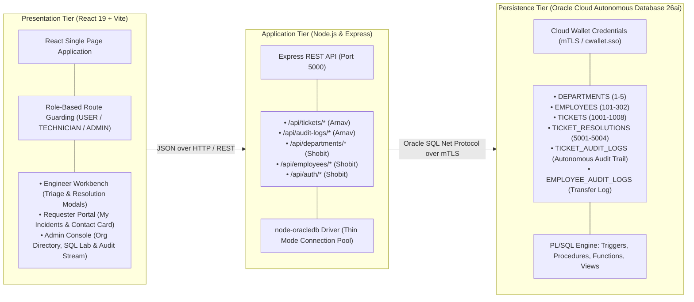
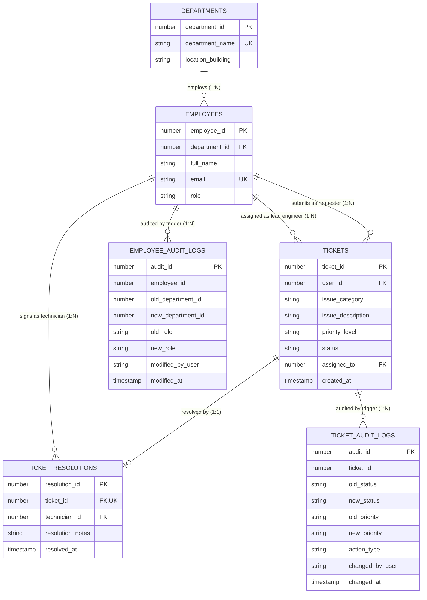

# IT Service Desk Incident & Ticketing System

> **DBMS Laboratory Project (Review 1 & Review 2)** &bull; Vellore Institute of Technology (VIT)  
> Full-Stack Enterprise Incident Management & IT Service Desk built on **Oracle Cloud Autonomous Database 26ai (ATP)**, **Node.js (Express REST API)**, and **React (Vite)**.

---

## 📋 Table of Contents
1. [Project Overview & Vision](#-project-overview--vision)
2. [Team Division & Ownership](#-team-division--ownership)
3. [System Architecture](#-system-architecture)
4. [Relational Database Design & ER Diagram](#-relational-database-design--er-diagram)
5. [Review 1 SQL Syllabus & Rubric Implementation](#-review-1-sql-syllabus--rubric-implementation)
6. [Review 2 Advanced PL/SQL Architecture](#-review-2-advanced-plsql-architecture)
7. [Business Logic & Concurrency Control](#-business-logic--concurrency-control)
8. [REST API Contract & Endpoints](#-rest-api-contract--endpoints)
9. [User Experience & Role-Based Workflows](#-user-experience--role-based-workflows)
10. [Project File Structure](#-project-file-structure)
11. [Step-by-Step Setup & Execution Guide](#-step-by-step-setup--execution-guide)
12. [Review 1 & 2 Viva Oral Exam Q&A](#-review-1--2-viva-oral-exam-qa)

---

## 📌 Project Overview & Vision

The **IT Service Desk Incident & Ticketing System** models operational enterprise IT workflows—from incident logging, priority triage, and technician dispatch to resolution diagnosis sign-off and autonomous audit logging.

### Key Highlights
- **ACID-Compliant Relational Core:** Eliminates orphaned tickets and unauthorized modifications through primary keys, foreign keys, identity sequences, domain check constraints, and cascade policies.
- **Enterprise Database Engine:** Runs on Oracle Cloud Autonomous Transaction Processing (ATP 26ai/19c) with secure Mutual TLS (mTLS) wallet connectivity.
- **Autonomous Row-Level Auditing:** Oracle PL/SQL triggers (`TRG_TICKET_AUDIT_TRAIL`) automatically record every state transition, priority shift, and deletion using `:OLD` vs `:NEW` pseudorecords into an immutable audit table.
- **Assignment & Criticality Concurrency Lockouts:** Enforces operational ownership. An engineer investigating a ticket is protected from peer overwrites, and resolved tickets have their criticality locked permanently.
- **Standardized Timezone (IST):** All database timestamps are converted and presented in Indian Standard Time (`Asia/Kolkata`).
- **Role-Based Workflows:** Tailored interfaces for **Corporate End Users** (log/track incidents), **Support Engineers** (investigate, adjust triage priority, submit technical resolutions), and **System Administrators** (staff directory, ticket management, SQL lab, and audit telemetry).

---

## 👥 Team Division & Ownership

The project is structured into two collaborative modules:

| Metric | Arnav Goel (`24BCT0189`) | Shobit Khanna (`24BCT0187`) |
| :--- | :--- | :--- |
| **Functional Domain** | **Incident & Resolution Management** | **Identity & Organization Management** |
| **Relational Tables** | `TICKETS`, `TICKET_RESOLUTIONS`, `TICKET_AUDIT_LOGS` | `DEPARTMENTS`, `EMPLOYEES`, `EMPLOYEE_AUDIT_LOGS` |
| **REST API Prefix** | `/api/tickets`, `/api/audit-logs` | `/api/departments`, `/api/employees`, `/api/auth` |
| **Seed ID Range** | Tickets: `1001`–`1008`<br/>Resolutions: `5001`–`5004` | Departments: `1`–`5`<br/>Employees: `101`–`302` |
| **Schema DDL Scripts** | `sql/01_schema.sql` | `sql/shobit_01_schema.sql` |
| **Seed DML Scripts** | `sql/02_seed_data.sql` | `sql/shobit_02_seed_data.sql` |
| **Review 1 Analytical SQL** | `sql/03_review1_queries.sql` | `sql/shobit_03_queries.sql` |
| **Review 2 PL/SQL Scripts** | `sql/04_arnav_review2_plsql.sql`<br/>`sql/05_arnav_review2_views.sql` | `sql/shobit_04_review2_plsql.sql`<br/>`sql/shobit_05_review2_views.sql` |
| **UI Views Owned** | Engineer Workbench (`/engineer`), Requester Portal (`/user`), Audit Stream (`/admin`) | Staff & Org Directory (`/admin`), Auth & Login (`/login`) |

---

## 🏗️ System Architecture



---

## 🗄️ Relational Database Design & ER Diagram

### Complete Entity-Relationship (ER) Diagram



### Relational Schema Summary
1. **`DEPARTMENTS` (`department_id` [PK], `department_name` [UK], `location_building`)**  
   Tracks enterprise divisions and campus facility locations.
2. **`EMPLOYEES` (`employee_id` [PK], `full_name`, `email` [UK], `role`, `department_id` [FK])**  
   Stores corporate users, support engineers, and administrators.
3. **`TICKETS` (`ticket_id` [PK], `user_id` [FK], `issue_category`, `issue_description`, `priority_level`, `status`, `assigned_to` [FK], `created_at`)**  
   Primary incident tracking table. `priority_level` is constrained to `LOW`, `MEDIUM`, `HIGH`, `CRITICAL`; `status` is constrained to `OPEN`, `IN_PROGRESS`, `RESOLVED`, `CLOSED`.
4. **`TICKET_RESOLUTIONS` (`resolution_id` [PK], `ticket_id` [FK, UNIQUE], `technician_id` [FK], `resolution_notes`, `resolved_at`)**  
   Strict 1-to-1 extension storing technical diagnoses, corrective actions, and completion timestamps.
5. **`TICKET_AUDIT_LOGS` (`audit_id` [PK], `ticket_id`, `old_status`, `new_status`, `old_priority`, `new_priority`, `action_type`, `changed_by_user`, `changed_at`)**  
   Immutable audit log written automatically by `TRG_TICKET_AUDIT_TRAIL`.
6. **`EMPLOYEE_AUDIT_LOGS` (`audit_id` [PK], `employee_id`, `old_department_id`, `new_department_id`, `old_role`, `new_role`, `modified_by_user`, `modified_at`)**  
   Captures staff transfers and role updates.

---

## 📊 Review 1 SQL Syllabus & Rubric Implementation

### 1. DDL & Integrity Constraints
- Primary keys, check constraints, unique constraints, and foreign keys.
- `ON DELETE CASCADE` from `TICKETS` to `TICKET_RESOLUTIONS`.
- `ON DELETE SET NULL` on `TICKETS.assigned_to` and `EMPLOYEES.department_id`.
- Identity columns (`GENERATED BY DEFAULT AS IDENTITY`).

### 2. Single-Row Functions
- `UPPER(issue_category)` & `LOWER(email)`: Case normalization.
- `INITCAP(location_building)`: Standard building title formatting.
- `LPAD(TO_CHAR(employee_id), 4, '0')`: Corporate badge generation (`EMP-0101`).
- `NVL(r.resolution_notes, 'Pending Assignment / Active Triage')`: Outer join substitution.
- `TO_CHAR(CAST(... AS TIMESTAMP WITH TIME ZONE) AT TIME ZONE 'Asia/Kolkata', ...)`: Timezone conversion to IST.

### 3. Aggregate Functions & GROUP BY with HAVING
- **Active Priority Queue (`HAVING COUNT(*) >= 2`):** Groups active tickets by priority to identify volume bottlenecks.
- **Department Staffing (`HAVING COUNT(employee_id) >= 2`):** Aggregates employees per department.
- **Turnaround Duration (`AVG`, `ROUND`):** Calculates average elapsed hours across completed resolutions.

---

## ⚡ Review 2 Advanced PL/SQL Architecture

### 1. Database Triggers

#### A. `TRG_TICKET_AUDIT_TRAIL` (Row-Level Audit Trigger)
Fires `AFTER UPDATE OR DELETE ON TICKETS FOR EACH ROW`. Intercepts every status transition, priority adjustment, or technician assignment.
```sql
CREATE OR REPLACE TRIGGER TRG_TICKET_AUDIT_TRAIL
AFTER UPDATE OR DELETE ON TICKETS
FOR EACH ROW
DECLARE
    v_action VARCHAR2(10);
    v_user   VARCHAR2(100);
BEGIN
    v_user := NVL(SYS_CONTEXT('USERENV', 'CLIENT_IDENTIFIER'), USER);

    IF DELETING THEN
        v_action := 'DELETE';
        INSERT INTO TICKET_AUDIT_LOGS (
            ticket_id, old_status, new_status, old_priority, new_priority, action_type, changed_by_user, changed_at
        ) VALUES (
            :OLD.ticket_id, :OLD.status, NULL, :OLD.priority_level, NULL, v_action, v_user, SYSTIMESTAMP
        );
    ELSIF UPDATING THEN
        v_action := 'UPDATE';
        IF (:OLD.status != :NEW.status) OR 
           (:OLD.priority_level != :NEW.priority_level) OR 
           (:OLD.assigned_to IS NULL AND :NEW.assigned_to IS NOT NULL) OR 
           (:OLD.assigned_to != :NEW.assigned_to) THEN
            
            INSERT INTO TICKET_AUDIT_LOGS (
                ticket_id, old_status, new_status, old_priority, new_priority, action_type, changed_by_user, changed_at
            ) VALUES (
                :NEW.ticket_id, :OLD.status, :NEW.status, :OLD.priority_level, :NEW.priority_level, v_action, v_user, SYSTIMESTAMP
            );
        END IF;
    END IF;
END;
/
```

#### B. `TRG_AUTO_RESOLVE_STATUS`
Fires `AFTER INSERT ON TICKET_RESOLUTIONS FOR EACH ROW` to automatically synchronize parent ticket status to `'RESOLVED'`.

### 2. Stored Procedures

#### `SP_RESOLVE_INCIDENT_TRANSACTION`
Encapsulates technician validation, resolution persistence, ticket status update, and explicit commit within an atomic transaction boundary with `SAVEPOINT` and rollback on exception.
```sql
CREATE OR REPLACE PROCEDURE SP_RESOLVE_INCIDENT_TRANSACTION (
    p_ticket_id        IN  NUMBER,
    p_technician_id    IN  NUMBER,
    p_resolution_notes IN  VARCHAR2,
    p_status_message   OUT VARCHAR2
) IS
    v_current_status VARCHAR2(20);
    v_assigned_to    NUMBER;
    v_tech_role      VARCHAR2(20);
    SAVEPOINT before_resolution;
BEGIN
    SELECT status, assigned_to INTO v_current_status, v_assigned_to
    FROM TICKETS WHERE ticket_id = p_ticket_id;

    IF v_current_status = 'RESOLVED' THEN
        p_status_message := 'ERROR: Ticket #' || p_ticket_id || ' is already resolved.';
        RETURN;
    END IF;

    SELECT role INTO v_tech_role FROM EMPLOYEES WHERE employee_id = p_technician_id;
    IF v_tech_role NOT IN ('TECHNICIAN', 'ADMIN') THEN
        p_status_message := 'ERROR: Only technicians or administrators can resolve incidents.';
        RETURN;
    END IF;

    IF v_assigned_to IS NOT NULL AND v_assigned_to != p_technician_id AND v_tech_role != 'ADMIN' THEN
        p_status_message := 'ERROR: Assigned to another engineer. Only the assigned lead can resolve.';
        RETURN;
    END IF;

    INSERT INTO TICKET_RESOLUTIONS (ticket_id, technician_id, resolution_notes, resolved_at)
    VALUES (p_ticket_id, p_technician_id, p_resolution_notes, SYSTIMESTAMP);

    UPDATE TICKETS
    SET status = 'RESOLVED',
        assigned_to = NVL(assigned_to, p_technician_id)
    WHERE ticket_id = p_ticket_id;

    COMMIT;
    p_status_message := 'SUCCESS: Incident #' || p_ticket_id || ' resolved successfully.';
EXCEPTION
    WHEN OTHERS THEN
        ROLLBACK TO before_resolution;
        p_status_message := 'ERROR: Transaction rolled back: ' || SQLERRM;
END;
/
```

### 3. Stored Functions
- **`FN_CALCULATE_RESOLUTION_TIME(p_ticket_id)`:** Returns turnaround duration in decimal hours between `created_at` and `resolved_at`.
- **`FN_GET_ENGINEER_ACTIVE_WORKLOAD(p_technician_id)`:** Returns total in-progress incidents assigned to a technician.

### 4. Relational Views & Set Operations
- **`VW_ACTIVE_INCIDENTS_DASHBOARD`:** Multi-table join view providing real-time incident queue metrics with formatted IST timestamps.
- **`VW_RESOLVED_TICKETS_SUMMARY`:** Resolution metrics joined with technician credentials.
- **Advanced Set Operations (`sql/05_arnav_review2_views.sql`):** `UNION`, `INTERSECT`, and `MINUS` queries tracking engineer involvement.

---

## 🔒 Business Logic & Concurrency Control

The application enforces strict database and API level concurrency rules:
1. **Criticality Lockout on Resolved Incidents:** Once an incident reaches `RESOLVED` or `CLOSED`, its priority level cannot be modified by any engineer. It renders as a locked badge (`🔒 CRITICAL`, `🔒 HIGH`) in the UI, and the API returns `400 Bad Request`.
2. **Assignment Ownership Protection:** When a technician claims an open ticket, its status shifts to `IN_PROGRESS` with their `employee_id`. Peer technicians cannot modify its priority or resolve it; the priority selector shows a locked badge (`🔒 MEDIUM`), and the resolve button shows `🔒 Locked`. Only the assigned engineer or an administrator can resolve the ticket.
3. **Descending Queue Ordering:** Tickets in the Engineer Workbench, Requester Portal, Admin Overview, and Audit Trail Stream are sorted descending by ID (`ticket_id DESC`, `audit_id DESC`), ensuring newly reported incidents and telemetry events appear immediately at the top.

---

## 🌐 REST API Contract & Endpoints

| Method | Endpoint | Description | Access / Parameters |
| :--- | :--- | :--- | :--- |
| `GET` | `/api/tickets` | List all tickets sorted descending with IST timestamps | All roles |
| `GET` | `/api/tickets/:id` | Fetch detailed single ticket with resolution | All roles |
| `POST` | `/api/tickets` | Submit new incident ticket (`status = 'OPEN'`) | `USER`, `ADMIN` |
| `PUT` | `/api/tickets/:id` | Update priority, status, or assignee (Enforces lockouts) | Lead Engineer, `ADMIN` |
| `DELETE`| `/api/tickets/:id` | Permanently remove incident (Cascades to resolutions) | `ADMIN` only |
| `POST` | `/api/tickets/:id/resolve` | Execute technical resolution with diagnosis notes | Assigned Technician, `ADMIN` |
| `GET` | `/api/tickets/metrics` | Returns analytical metrics and queue volumes | All roles |
| `GET` | `/api/audit-logs` | Fetch live row-level audit trail from Oracle triggers | `ADMIN` only |
| `POST` | `/api/audit-logs/simulate-trigger` | Fires live trigger mutation test for oral defense | `ADMIN` only |
| `GET` | `/api/departments` | List campus departments | All roles |
| `GET` | `/api/employees` | List corporate workforce | All roles |
| `POST` | `/api/employees` | Register new employee | `ADMIN` only |
| `DELETE`| `/api/employees/:id` | Delete employee record | `ADMIN` only |

---

## 🎨 User Experience & Role-Based Workflows

```
[ Active Profile: End User (USER) ▼ ]  OR  [ Support Engineer (TECHNICIAN) ▼ ]  OR  [ System Administrator (ADMIN) ▼ ]
```

### 1. End User (`/user`)
- Incident self-service portal.
- Submits tickets with category, description, and auto-populated badge credentials.
- Monitors progress with real-time status badges, investigating engineer contact details (email and building location), and official resolution diagnosis notes.

### 2. Support Engineer (`/engineer`)
- Queue triage and troubleshooting workbench.
- Categories sidebar filter (`NETWORK`, `HARDWARE`, `SOFTWARE`, `ACCOUNT_ACCESS`, `EMAIL`).
- Claims open tickets via the **Investigation Brief Modal**, transitioning status to `IN_PROGRESS`.
- Submits corrective diagnosis notes to resolve tickets.
- Criticality dropdowns are locked on peer-assigned or resolved tickets.

### 3. System Administrator (`/admin`)
- Four dedicated management consoles:
  1. **Staff & Organization:** Department cards, personnel headcount, employee directory, and registration modal.
  2. **Tickets:** Enterprise incident oversight with search, filters, and deletion controls.
  3. **Analytical SQL Lab:** Live execution of character, aggregate, and `HAVING` threshold queries.
  4. **Audit Trail & Triggers:** Real-time stream of `TRG_TICKET_AUDIT_TRAIL` events with `:OLD` to `:NEW` transitions and IST timestamps.

---

## 📂 Project File Structure

```text
ticketing-system/
├── client/                     # Frontend Application (React 19 + Vite)
│   ├── src/
│   │   ├── components/
│   │   │   └── Login.jsx       # Multi-persona login component
│   │   ├── App.jsx             # Main SPA Dashboard, Modals, RBAC & IST Formatter
│   │   ├── index.css           # Vanilla CSS Design System & Theme Tokens
│   │   └── main.jsx            # React root mount
│   ├── package.json            # Client dependencies
│   └── vite.config.js          # Vite build config & proxy to Port 5000
│
├── server/                     # Backend API Bridge (Express.js)
│   ├── wallet/                 # Oracle Cloud Autonomous DB Wallet (gitignored)
│   ├── routes/
│   │   ├── tickets.js          # Arnav: /api/tickets routes & concurrency checks
│   │   ├── audit.js            # Arnav: /api/audit-logs trigger telemetry
│   │   ├── departments.js      # Shobit: /api/departments endpoints
│   │   ├── employees.js        # Shobit: /api/employees endpoints
│   │   └── auth.js             # Shobit: /api/auth login endpoint
│   ├── db.js                   # node-oracledb connection pool manager
│   ├── server.js               # Express application entrypoint
│   ├── .env                    # Cloud database credentials (gitignored)
│   └── package.json            # Backend dependencies
│
├── sql/                        # Oracle Relational SQL & PL/SQL Deliverables
│   ├── 01_schema.sql           # Arnav: TICKETS & TICKET_RESOLUTIONS DDL
│   ├── 02_seed_data.sql        # Arnav: Tickets & Resolutions Seed DML
│   ├── 03_review1_queries.sql  # Arnav: Single-Row & Group Aggregate Queries
│   ├── 04_arnav_review2_plsql.sql # Arnav: Audit Trigger, Stored Procedure, Function
│   ├── 05_arnav_review2_views.sql # Arnav: Views & Set Operations
│   ├── shobit_01_schema.sql    # Shobit: DEPARTMENTS & EMPLOYEES DDL
│   ├── shobit_02_seed_data.sql # Shobit: Departments & Personnel Seed DML
│   ├── shobit_03_queries.sql   # Shobit: Single-Row & Headcount Aggregate Queries
│   ├── shobit_04_review2_plsql.sql # Shobit: Employee Audit Trigger & Transfer Procedure
│   └── shobit_05_review2_views.sql # Shobit: Organization Views & Set Operations
│
├── DBMS_Project_Report.docx    # Complete 10-Marks Project Report (Word Document)
├── .gitignore                  # Git ignore rules (node_modules, wallet, .env)
└── README.md                   # Complete system documentation (This file)
```

---

## 🚀 Step-by-Step Setup & Execution Guide

### 1. Database Initialization
Connect to your Oracle Autonomous Database using Oracle SQL Developer or Web SQL Worksheet:
```sql
-- Step 1: Execute Schema DDL
@sql/shobit_01_schema.sql
@sql/01_schema.sql

-- Step 2: Execute Seed DML
@sql/shobit_02_seed_data.sql
@sql/02_seed_data.sql

-- Step 3: Compile Review 2 PL/SQL Triggers, Procedures, and Functions
@sql/shobit_04_review2_plsql.sql
@sql/04_arnav_review2_plsql.sql

-- Step 4: Create Views
@sql/shobit_05_review2_views.sql
@sql/05_arnav_review2_views.sql
```

### 2. Backend Server Setup
Extract your Oracle Cloud Wallet zip archive into `server/wallet/` (ensure `cwallet.sso` and `tnsnames.ora` exist inside).

```bash
cd server
npm install
```

Configure your environment file `server/.env`:
```env
PORT=5000
DB_USER=ADMIN
DB_PASSWORD=YourOraclePasswordHere
DB_CONNECT_STRING=ticketdb_high
TNS_ADMIN=./wallet
```

Start the Express backend:
```bash
node server.js
```

### 3. Frontend Client Setup
In a second terminal window:
```bash
cd client
npm install
npm run dev
```
Open **`http://localhost:3000`** in your browser.

---

## 🎓 Review 1 & 2 Viva Oral Exam Q&A

### Q1: How does your trigger `TRG_TICKET_AUDIT_TRAIL` capture old and new values?
* **Answer:** In Oracle, an `AFTER UPDATE OR DELETE FOR EACH ROW` trigger exposes `:OLD` and `:NEW` pseudorecords. When a ticket is updated, `:OLD.status` holds the value prior to modification and `:NEW.status` holds the newly assigned value. The trigger checks if status or priority changed and automatically inserts a row into `TICKET_AUDIT_LOGS` with `SYSTIMESTAMP`. When a ticket is deleted, `:OLD` holds the deleted data and `:NEW` is `NULL`.

### Q2: Why did you use an autonomous or database-level trigger instead of logging in Node.js?
* **Answer:** Application-level logging can be bypassed if an administrator updates data directly via SQL Developer, SQL*Plus, or external microservices. A database-level trigger guarantees non-repudiation and complete audit compliance because it executes inside the database kernel regardless of what application initiates the transaction.

### Q3: What is the purpose of `SAVEPOINT` in `SP_RESOLVE_INCIDENT_TRANSACTION`?
* **Answer:** `SAVEPOINT before_resolution` establishes an intermediate marker within the database transaction. If any constraint violation occurs during the procedure (e.g., an unauthorized technician attempts to resolve), the exception block issues `ROLLBACK TO before_resolution`. This rolls back only the uncommitted changes made within the procedure without aborting the entire database session.

### Q4: How does the system prevent race conditions between support engineers?
* **Answer:** When an engineer claims an open ticket via the Investigation Brief, the system assigns their `employee_id` to `TICKETS.assigned_to` and sets status to `IN_PROGRESS`. Both the frontend UI and the backend API verify assignment ownership: peer technicians cannot adjust priority or resolve the ticket. Additionally, stored procedure `SP_RESOLVE_INCIDENT_TRANSACTION` rejects resolutions submitted by non-assigned technicians.

### Q5: How do you format timestamps into Indian Standard Time (IST)?
* **Answer:** Oracle Autonomous Database stores timestamps in UTC. In SQL, we convert them using:
  `TO_CHAR(CAST(t.created_at AS TIMESTAMP WITH TIME ZONE) AT TIME ZONE 'Asia/Kolkata', 'DD-Mon-YYYY HH12:MI:SS AM') || ' IST'`.
  On the frontend, helper function `formatISTDisplay()` ensures dates are localized to `Asia/Kolkata` with a 12-hour AM/PM format.

### Q6: What normal forms does your schema satisfy?
* **Answer:** The schema satisfies **1NF** (atomic values, no multi-valued attributes), **2NF** (all tables have single-attribute primary keys, eliminating partial dependencies), **3NF** (no transitive dependencies; department location is kept in `DEPARTMENTS` rather than duplicated in `EMPLOYEES` or `TICKETS`), and **BCNF** (every determinant in all functional dependencies is a candidate key).

---

## 📄 Academic Evaluation

Developed for academic evaluation in the **Database Systems Laboratory (Review 1 & Review 2)** at **Vellore Institute of Technology (VIT)**.  
Authors: **Arnav Goel (`24BCT0189`)** & **Shobit Khanna (`24BCT0187`)**.